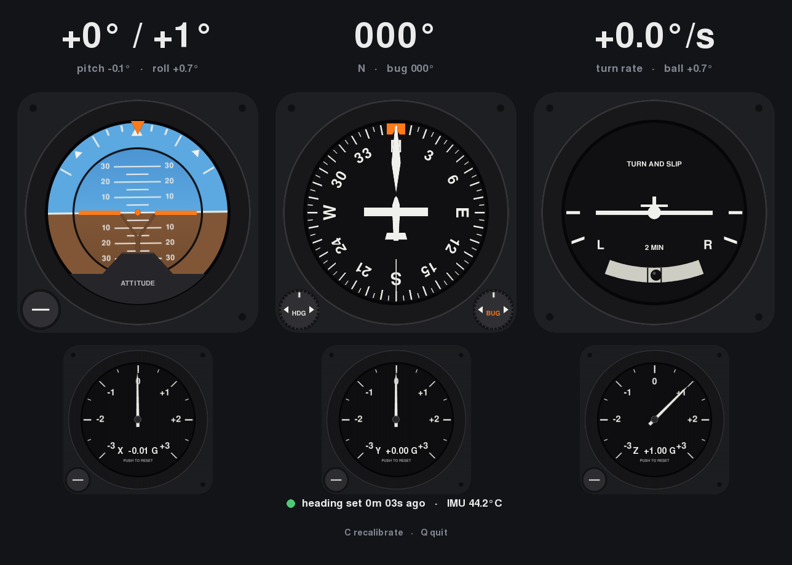

# gyro-instruments-mac

Turns your MacBook into half of a six-pack.

An attitude indicator, directional gyro, turn-and-slip indicator and per-axis G meters, all driven by the MacBook's inertial measurement unit (IMU).



## Reading the IMU

Apple Silicon MacBooks have a Bosch BMI282 IMU (gyro and accelerometer) on the always-on sensor hub, and macOS exposes it as vendor HID devices. It's silent until its `AppleSPUHIDDriver` gets `SensorPropertyReportingState`, `SensorPropertyPowerState` and a `ReportInterval`. Setting the interval back to 0 stops it. No root is needed.

`imu.c` does that and queues every report, and `sensors.py` drains the queue through ctypes. Each sample gives:
- gyro rates $\omega_x, \omega_y, \omega_z$ in °/s
- accelerations $a_x, a_y, a_z$ in g (lying flat, about (0, 0, −1))

Details of the hardware probing are in [sensors.md](sensors.md).

## How each value is computed

In the formulas below:
- $\Delta t$ is the time between samples.
- $s = \pm1$ is each axis's sign (`HEADING_SIGN`, `PITCH_SIGN`, `ROLL_SIGN` in `sensors.py`).
- $\text{lag}_\tau(x)$ means a smoothed value $y$ updated toward $x$ by $y \leftarrow y + \frac{\Delta t}{\tau + \Delta t}(x - y)$.

**Rates.** The gyro bias $b$ is each axis's mean over 3 s while the laptop sits still (`C` redoes it):

$$
\dot\psi = s_\psi(\omega_z - b_z) \quad\text{yaw}, \qquad
\dot\theta = s_\theta(\omega_x - b_x) \quad\text{pitch}, \qquad
\dot\phi = s_\phi(\omega_y - b_y) \quad\text{roll}
$$

**Turn rate (turn-and-slip).** Standard rate (3°/s) puts the plane on the L/R mark.

$$
r = \text{lag}_{0.3\,\text{s}}(\dot\psi)
$$

**Heading (DG).** There's no magnetometer, so heading has no correction. The HDG knob adds an offset to line it up.

$$
\psi \leftarrow (\psi + \dot\psi\,\Delta t) \bmod 360°
$$

**Pitch and roll (AI).** First integrate the gyro, then pull the result toward the accelerometer's gravity angles so it doesn't drift. The pull is applied only while $\lVert a\rVert \approx 1$ g.

$$
\theta^g = s_\theta\operatorname{atan2}(-a_y, -a_z), \qquad
\phi^g = s_\phi\operatorname{atan2}(a_x, -a_z)
$$

$$
\theta \leftarrow \theta + \dot\theta\,\Delta t, \qquad
\theta \leftarrow \theta + \frac{\Delta t}{2\,\text{s} + \Delta t}\left(\theta^g - \theta\right)
\qquad \text{(and the same for } \phi\text{)}
$$

**Ball (turn-and-slip).** Apparent gravity projected on the X–Z plane, as an angle from straight down, which is where a ball in a curved tube rests. The lag stands in for the damping fluid.

$$
\beta = \text{lag}_{0.15\,\text{s}}\!\left(s_\phi\operatorname{atan2}(a_x, -a_z)\right)
$$

**Acceleration (G meters).** Load factor on each axis: the negated reading, so lying flat shows Z = +1 G. At rest that 1 G is the desk pushing up. Orange tattletales hold the min and max until you click PUSH.

$$
n_i = \text{lag}_{0.1\,\text{s}}(-a_i), \qquad i \in \{x, y, z\}
$$

## Requirements

- An Apple Silicon MacBook running macOS
- The Xcode command-line tools: `xcode-select --install`
- [uv](https://docs.astral.sh/uv/): `brew install uv`. It installs Python and `pygame-ce` on first run. Without uv, use `pip install pygame-ce`.

## Run

```sh
make run
```

- **Set heading or the heading bug:** click the arrows on the DG's HDG or BUG knob (hold to repeat), or scroll over the knob.
- **Reset a G meter's tattletales:** click its PUSH knob.
- **`C`** recalibrates the gyro bias. **`Q`** quits.

## Files

| File | Role |
|---|---|
| `imu.c` | Streams the gyro and accelerometer: `imu_start`, `imu_read`, `imu_stop` |
| `sensors.py` | Bias, rates, angles, ball and G per axis (the formulas above) |
| `attitude_indicator.py`, `directional_gyro.py`, `turn_coordinator.py`, `g_meter.py` | The instruments |
| `compass.py` | Window, layout, input |
| `art.py`, `assets/`, `make_assets.py` | Instrument art: loader, PNG layers, and the script that draws them |
